 

## 👨‍💻 About Me

- 🎓 Pursuing **B.Tech in Computer Engineering** at **Marwadi University, Rajkot** *(2022 – 2026)*
- 💻 Passionate about **Full Stack Web Development** with a focus on the **MERN Stack**
- 🏆 **Hackathon Participant** — competed in **Web-Hack 1.0** by Dev Disect Community
- 🌱 Currently exploring **TypeScript**, **Redux**, and **Cloud Deployment**
- 📫 Reach me at **[Tanmaypatel5504@gmail.com](mailto:Tanmaypatel5504@gmail.com)**
- ⚡ I love turning ideas into real, working web apps!

---

## 🛠️ Tech Stack

**Languages**

**Frontend**

**Backend & Database**

**Tools & Platforms**

---

## 🚀 Featured Projects

<table>
  <tr>
    <td width="50%" valign="top">
      <h3>🔨 <a href="https://github.com/Tanmay9724349/Auction_Website">Auction Website</a></h3>
      
A full-stack auction platform where users can create listings and place competitive bids in real time.

      <ul>
        <li>🔐 User authentication &amp; role-based access</li>
        <li>⚙️ RESTful APIs with Node.js &amp; Express.js</li>
        <li>🗄️ MongoDB + Mongoose ODM for data management</li>
        <li>📱 Responsive React.js frontend</li>
      </ul>
      

        
        
        
        
      

    </td>
    <td width="50%" valign="top">
      <h3>⚡ <a href="https://github.com/Tanmay9724349/Web-Hack-1.0">Web-Hack 1.0</a></h3>
      
Hackathon project built for <strong>Web-Hack 1.0</strong> organized by the Dev Disect Community.

      <ul>
        <li>🤝 Team collaboration under competitive deadline</li>
        <li>⚛️ React.js component-driven frontend (84%+ JS)</li>
        <li>🔧 Backend module for server-side logic</li>
        <li>🏁 Rapid prototyping &amp; delivery</li>
      </ul>
      

        
        
        
        
      

    </td>
  </tr>
</table>

---

## 📊 GitHub Stats

&nbsp;&nbsp;

 

  

---

## 📜 Certifications

| 🏅 Certificate | 🏛️ Issuer | 📅 Date | 🔗 |
|:---|:---|:---:|:---:|
| Programming for Everybody (Getting Started with Python) | University of Michigan — Coursera | Aug 2023 | [Verify ↗](https://coursera.org/verify/PJQNMPA3DV9N) |
| Python Data Structures | University of Michigan — Coursera | Aug 2023 | [Verify ↗](https://coursera.org/verify/9Y7LP9YJW8TD) |

---

## 📚 Currently Learning

---

### 💬 Let's Connect!

 

 

> *"Code is like humor. When you have to explain it, it's bad."* — Cory House

